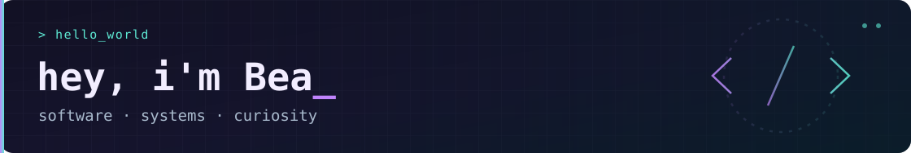

**Computer Engineering · Software Development · Problem Solving**

Double-degree student at University of Campinas (UNICAMP) 🇧🇷 and IMT Atlantique 🇫🇷 
Specializing in Collaborative Software Development 

### 👩🏻‍💻 About me

I'm a Brazilian Computer Engineering student currently pursuing a double degree in France, with a focus on software engineering, algorithms, and collaborative development. 

I enjoy turning ideas into well-structured programs, understanding the decisions behind an architecture, and learning across disciplines. My background also includes scientific research in nanofabrication, which strengthened my approach to experimentation and problem-solving. 

### Tech stack

**Languages:** `Python` · `Java` · `C` · `Assembly`  
**Tools & concepts:** `Git` · `GitHub` · `OOP` · `UML` · `NumPy`  
**Currently exploring:** `Haskell` · `Software Design Patterns`

### Let's connect 

📫 **[Email me](mailto:beatrizbarbosay7@gmail.com)** · 💼 **[LinkedIn](https://www.linkedin.com/in/ana-beatriz-barbosa-yoshida-5aa925218/)**

